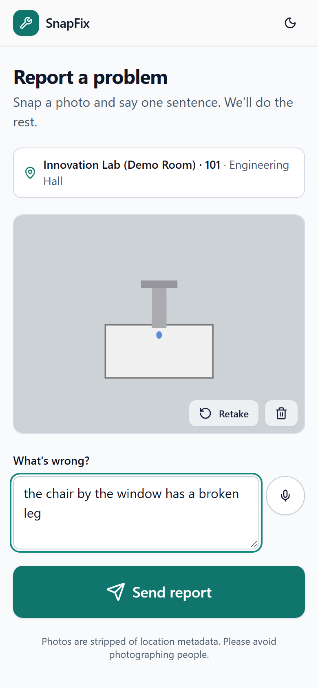
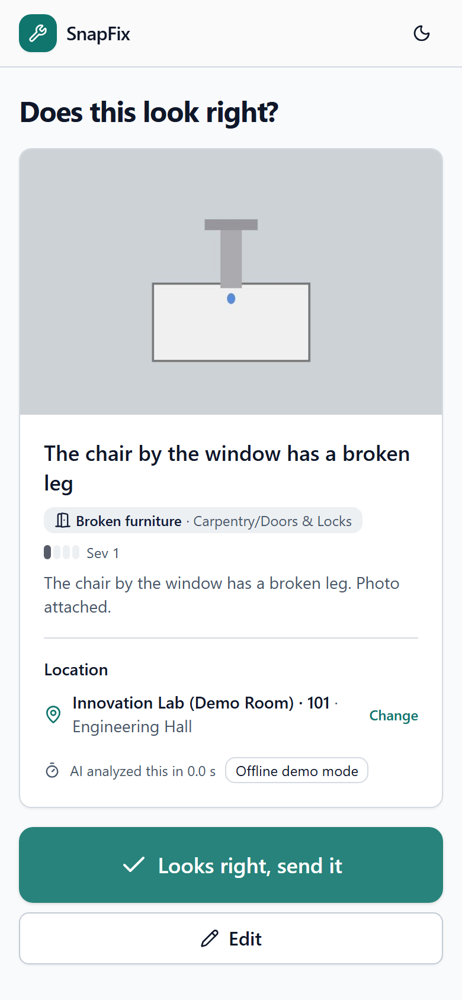
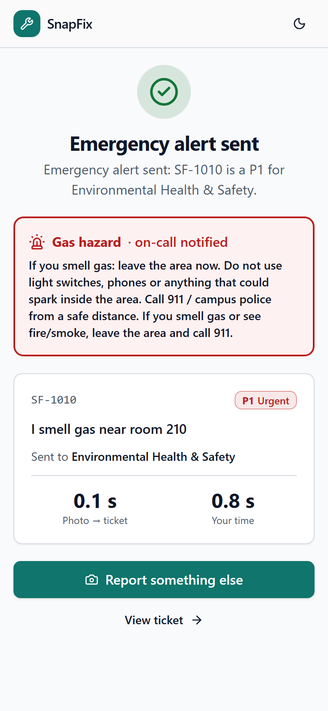
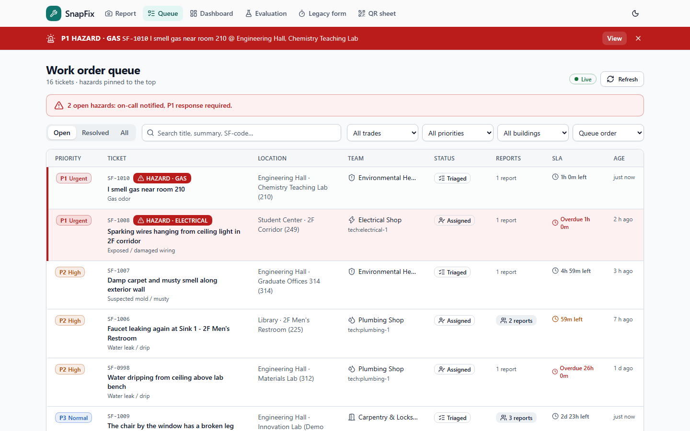
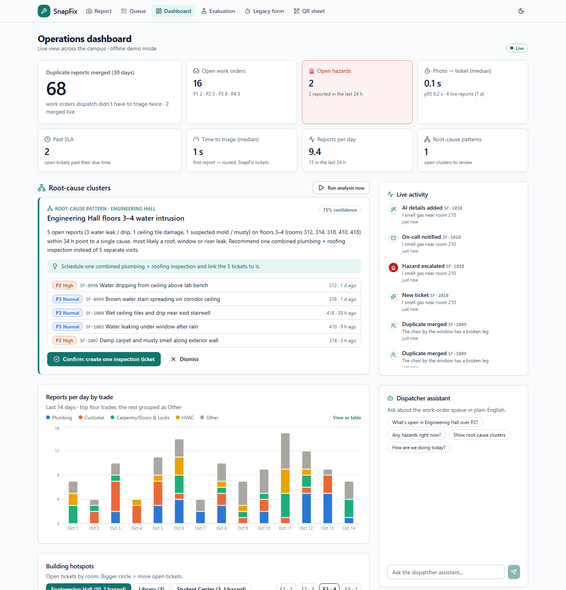
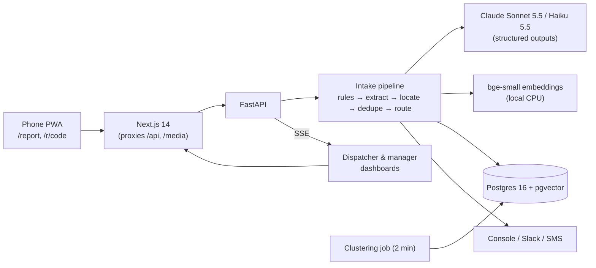

# SnapFix

**Snap a photo, say one sentence, and SnapFix creates the work order.** A GenAI copilot for facilities
maintenance: it turns a photo plus one spoken sentence into a structured, routed, de-duplicated, prioritized work
order in seconds. Hazards escalate instantly, managers see root-cause clusters, and technicians get an AI brief
with the asset's history and the right repair procedure.

Built for the GMU Challenge+X "GenAI for Everyday Operations" showcase (November 7, 2026).

| Report (phone) | Confirm | Hazard |
|---|---|---|
|  |  |  |




## The problem

Every campus, hospital, office and city has something broken every day.

1. **Reporting is painful.** People have to find a portal, pick a category from a long dropdown and describe the exact
   location. Many give up, so problems go unreported or are reported vaguely ("bathroom broken").
2. **Triage is manual.** Dispatchers read vague tickets, guess trade and priority, miss duplicates (ten people report
   the same leak) and miss that several small reports share one root cause.
3. **Technicians arrive under-informed**, without the asset history or the relevant repair procedure.

## What SnapFix does

- **Photo + one sentence → work order.** Claude Sonnet 5.5 reads the photo and the sentence and fills a fixed schema
  (category, trade, severity, asset, location clues). Location comes from the QR sticker, the words used, a room sign
  in the photo, or GPS. It never invents a room.
- **Hazards escalate instantly, with no AI in the loop.** Deterministic keyword rules ("smell gas", "sparking",
  "water pouring", ...) create a P1 ticket and alert on-call in about 0.2 s. The model can add a hazard but can never
  remove one.
- **No duplicate tickets.** Embeddings + pgvector find open tickets nearby. Strong same-room matches merge, and
  borderline ones get a second opinion from Claude Haiku 5.5. The reporter sees "Already reported (SF-1042), 3 people
  have reported this."
- **Root causes.** Clustering spots patterns such as five water reports on floors 3–4 in 36 hours, and Haiku writes the
  hypothesis: "likely roof or riser leak; one inspection instead of five visits."
- **Technician brief.** Likely causes, a tools checklist, and safety steps and procedure **quoted from the SOPs with
  section citations**, plus "same sink failed 21 days ago".
- **Trust.** Every AI decision is logged with its rationale and scores (the AI decision log on each ticket), and the
  `/eval` page shows measured accuracy.

## Quick start (5 commands)

Requirements: Docker Desktop and GNU make. On Windows without make, run the `docker compose` line shown in the comment.

```bash
git clone <your-repo-url> snapfix && cd snapfix
cp .env.example .env     # add ANTHROPIC_API_KEY; without it SnapFix runs in offline demo (mock) mode
make dev                 # = docker compose up -d --build --wait  (Postgres+pgvector, API, web; seeds demo data on first start)
# open http://localhost:3000
make demo-reset          # any time: restore the exact demo starting state
```

**Windows, one click:** double-click `start.cmd`. It starts Docker Desktop if needed, waits for the engine,
starts SnapFix and opens the dashboard. `start.cmd -Reset` also restores the demo starting state, and `stop.cmd`
stops everything (your data is kept).

The first build downloads Python/Node dependencies and the local embedding model (about 5 minutes). Later starts take
seconds.

| URL | For | What |
|---|---|---|
| `/report`, `/r/<code>` | Anyone (phone) | Photo + voice/text report; `/r/engr-101` pre-fills the room from a QR sticker |
| `/tickets` | Dispatcher | Live queue: hazards pinned, SLA countdown, report counts, filters |
| `/tickets/<code>` | Dispatcher / technician | Photos, floor plan, asset history, technician brief, AI decision log |
| `/dashboard` | Manager | KPIs, root-cause clusters, trend, hotspots, live feed, dispatcher assistant |
| `/eval` | Judges | Measured accuracy, hazard recall, dedupe F1, latency, cost, time-to-report |
| `/baseline` | Study | A typical 14-field legacy form with a timer (for the time-to-report comparison) |
| `/admin/qr` | Organizers | Printable QR stickers for every room |
| `/admin` | Operator (hidden) | Offline-mock switch, demo reset (needs `ADMIN_TOKEN`) |
| `:8000/docs` | Developers | OpenAPI for the backend |

## Using real phones (HTTPS)

Phone cameras and microphones only work over HTTPS. The browser only talks to the Next.js app, which proxies `/api`
and `/media` to the backend, so **one tunnel to port 3000 is enough**.

**Option A: tunnel (quickest, recommended for the showcase)**

```bash
cloudflared tunnel --url http://localhost:3000     # or: ngrok http 3000
```

Open the printed `https://….trycloudflare.com` URL on the phone. Then go to `/admin/qr`, paste that URL as the public
base URL, and print the stickers. Each sticker opens `/r/<room>` with the location filled in.

**Option B: deploy**

- **Database:** Postgres 16 with the pgvector extension (Neon, Render, Railway or Fly Postgres).
- **Backend:** deploy `backend/` (it has a Dockerfile) to Render, Fly or Railway. Set `DATABASE_URL`,
  `ANTHROPIC_API_KEY`, `ADMIN_TOKEN` and `FRONTEND_ORIGIN`. The container migrates, seeds on first start and serves on
  :8000.
- **Frontend:** deploy `frontend/` to Vercel with `BACKEND_URL=https://<your-backend>` (used by the rewrites at build
  time). If your host buffers the event stream, also set `NEXT_PUBLIC_STREAM_URL=https://<your-backend>/api/stream`
  (CORS allows `FRONTEND_ORIGIN`).

## Make targets

| Command | What it does |
|---|---|
| `make dev` | Build and start everything (detached) and wait until healthy |
| `make seed` | Wipe and reseed the demo database |
| `make demo-reset` | Reseed and reset runtime switches (through the admin endpoint) |
| `make test` | Backend tests (pytest, 274 tests, SQLite + mock AI, no network) + frontend typecheck/lint |
| `make test-e2e` | Playwright: report → queue, live SSE, hazards, dashboard, brief, accessibility (axe), full demo script |
| `make eval` / `make eval-mock` | Evaluation harness → `eval/results/*.json` (shown on `/eval`) |
| `make db` + `make backend` + `make frontend` | Local development with hot reload (only Postgres in Docker) |
| `make down` / `make logs` | Stop / follow logs |

## Environment variables

| Variable | Default | Notes |
|---|---|---|
| `ANTHROPIC_API_KEY` | empty | Needed for live AI. Without it the app runs in deterministic mock mode |
| `ANTHROPIC_MODEL_MAIN` / `ANTHROPIC_MODEL_FAST` | `claude-sonnet-5-5` / `claude-haiku-5-5` | The only place model names live |
| `LLM_MODE` | `live` | `live` or `mock`; can also be switched at runtime from `/admin` |
| `DATABASE_URL` | compose: `postgresql+psycopg://snapfix:snapfix@db:5432/snapfix` | |
| `EMBEDDING_MODEL` | `BAAI/bge-small-en-v1.5` | Local, CPU; baked into the backend image |
| `STT_FALLBACK` | `faster-whisper` | Server transcription when the browser lacks speech recognition (`uv sync --extra stt`) |
| `NOTIFIER` | `console` | `console`, `slack` (`SLACK_WEBHOOK_URL`) or `twilio` (`TWILIO_*`, `ALERT_TO`) |
| `ADMIN_TOKEN` | `change-me` | **Change it** before exposing the app |
| `FRONTEND_ORIGIN` | `http://localhost:3000` | CORS origin for direct API calls |
| `NEXT_PUBLIC_API_URL` | `http://localhost:8000` | Backend URL the Next.js proxy uses when `BACKEND_URL` isn't set |
| `BLUR_FACES` | `false` | Blur faces in uploaded photos (`uv sync --extra vision` for OpenCV) |
| `EMERGENCY_TEXT` | "If you smell gas or see fire/smoke, leave the area and call 911." | Shown to reporters of hazards |

## Architecture in one picture



Details: [docs/ARCHITECTURE.md](docs/ARCHITECTURE.md) · decisions and deviations from the brief:
[DECISIONS.md](DECISIONS.md) · demo run-of-show: [docs/DEMO_SCRIPT.md](docs/DEMO_SCRIPT.md) · pitch:
[docs/PITCH_NOTES.md](docs/PITCH_NOTES.md) · changes per phase: [CHANGELOG.md](CHANGELOG.md).

## Testing and evaluation

- `make test`: unit and integration tests for taxonomy, every hazard keyword, routing/SLA, dedupe scoring, location
  parsing, extraction (mock and the exact live request shape against a stubbed client), the full intake pipeline,
  hazards with the LLM down, clustering, briefs and citations, KPIs and the agent loop.
- `make test-e2e`: Playwright on a mobile profile against the running stack. It covers QR report → ticket in queue, live
  updates and the hazard bar over SSE, the dashboard cluster and assistant, the SOP-cited brief, axe accessibility on 8
  pages × light/dark, and the complete demo script (it passes 3 times in a row from `demo-reset`).
- `make eval`: 98 labelled reports through the real pipeline on an isolated database. The committed run is **mock mode**:
  hazard recall 100%, dedupe F1 97.1%, keyword-baseline category accuracy 85.7%. Run it with an API key for Claude's real
  numbers, and add real photos to `eval/dataset/` (see [eval/README.md](eval/README.md)).

## Privacy and safety

- EXIF metadata (including GPS) is stripped before photos are stored. GPS is read first, only to suggest a building.
- Reporter name and contact are optional and never sent to the model. Optional face blurring is available.
- Synthetic data only: the seeded campus, assets and tickets are fictional.
- Safety never depends on the model: keyword rules escalate hazards, the model can only add one, and routing and
  priority are deterministic code.

## Known limitations

- **Live mode was not exercised in this build environment**, because no API key was available. The exact request
  shape (structured outputs, cached system prompt, base64 photo, effort, no forced tool use) is unit-tested against a
  stubbed client, and every call falls back gracefully. Do one live run (`make eval` with a key, plus a real phone
  photo) before the showcase.
- The evaluation set is text-only until the team adds campus photos. Location results from text alone cover 17 items.
- The SSE broker is in-process: run one backend instance (fine for the showcase).
- CLIP image similarity for dedupe (an optional stretch goal) is not implemented. See DECISIONS.md.

## Project layout

```
backend/   FastAPI app (app/ai: extract, hazards, dedupe, routing, cluster, brief, agent, llm), seed data + SOPs, tests
frontend/  Next.js 14 app (report PWA, queue, ticket detail, dashboard, eval, baseline, QR sheet), Playwright e2e
eval/      labelled dataset, run_eval.py, results
docs/      architecture, demo script, pitch notes, screenshots
```
