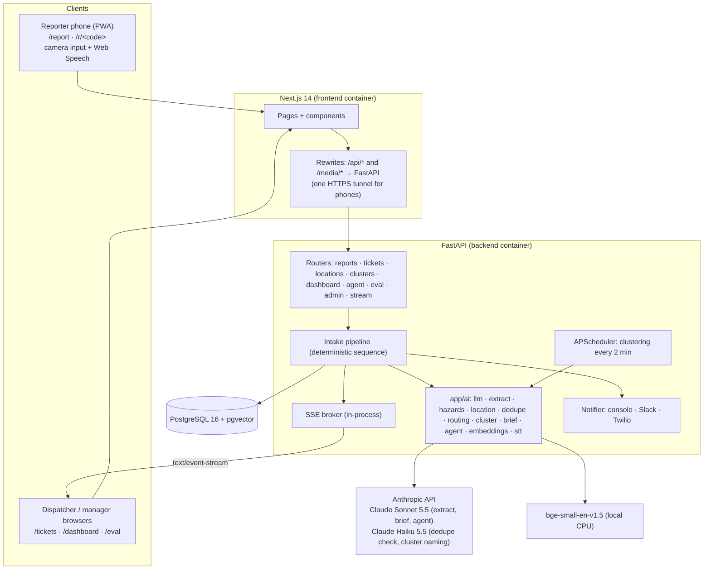
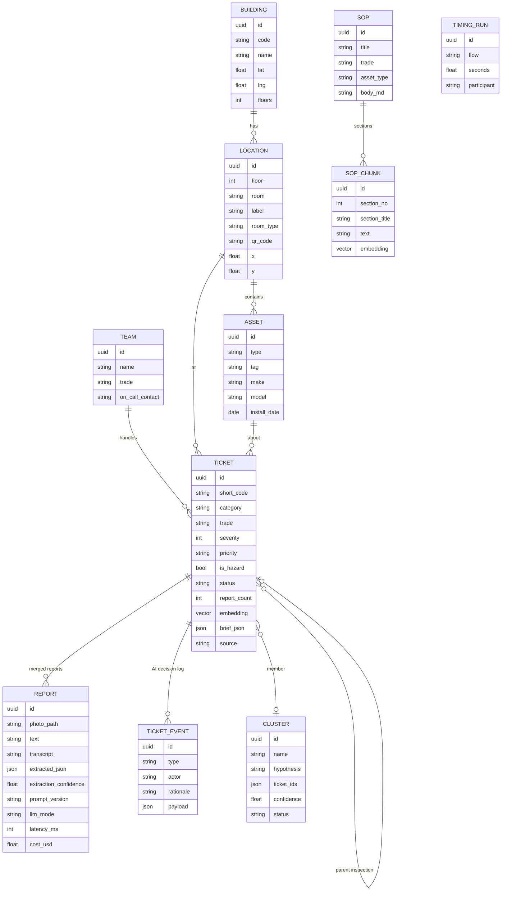

# SnapFix architecture

## System overview



## Intake pipeline

```mermaid
sequenceDiagram
  autonumber
  actor Reporter
  participant Web as Next.js
  participant API as FastAPI /api/reports
  participant Rules as Hazard rules
  participant LLM as Claude Sonnet 5.5
  participant Loc as Location resolver
  participant Dup as Dedupe (pgvector + Haiku)
  participant DB as Postgres
  participant Live as SSE + notifier

  Reporter->>Web: photo + one sentence (QR room pre-filled)
  Web->>API: multipart POST (photo downscaled, EXIF GPS as lat/lng)
  API->>API: validate, strip EXIF, resize 1568px, optional face blur
  API->>Rules: keyword rules on text/transcript
  alt hazard rule fires (no LLM)
    Rules-->>API: gas / electrical / fire / water / ...
    API->>Loc: QR → text → GPS
    API->>Dup: same room + same hazard? merge : create
    API->>DB: P1 ticket + escalated event (~0.2 s)
    API->>Live: hazard.alert + on-call alert (background thread)
    API-->>Reporter: safety instructions + ticket number
    API->>LLM: enrichment afterwards (title/summary/asset); hazard kept
  else normal report
    API->>LLM: structured output (TicketDraft schema), cached system prompt, effort low
    LLM-->>API: category, trade, severity, evidence, location clues, confidence
    API->>Loc: QR → room in text → sign in photo → GPS → ask the user
    API-->>Reporter: confirmation card (one tap, or edit)
    Reporter->>API: POST /api/reports/{id}/confirm
    API->>Dup: embed → KNN open tickets (same building, 72 h) → score → Haiku if borderline
    alt duplicate
      API->>DB: attach report, report_count+1, severity only up
      API-->>Reporter: "Already reported (SF-1042). 3 people have reported this."
    else new
      API->>DB: route (trade → team, severity × criticality → priority/SLA) + audit events
    end
    API->>Live: ticket.created / ticket.merged (+ hazard.alert if escalated)
  end
```

**Location resolution order:** QR code (`/r/<code>`) → explicit room in the words used ("room 210", "2nd floor men's
room in the library", named rooms) → room sign read in the photo → GPS (building only) → ask the user, with candidate
quick picks. It never guesses a room.

**Dedupe score** = 0.55 × text similarity + 0.25 × location (same room 1.0 / floor 0.6 / building 0.3) + 0.20 ×
category match. The cosine similarity is rescaled for bge-small (0.55 → 0, 0.90 → 1).
- Score ≥ 0.80 in the same room → merge automatically.
- Score ≥ 0.60 otherwise → ask Haiku: "same physical issue?"
- Below that → new ticket.

A per-building Postgres advisory lock serializes dedupe + create, so simultaneous reports can't produce two tickets.

**Routing** is deterministic code:
- **Team:** trade comes from the category through a fixed map, and each trade has one team.
- **Priority:** severity + 1 for high-criticality rooms (labs, restrooms, elevators, mechanical spaces). Hazards
  force P1.
- **SLA:** P1 1 h · P2 8 h · P3 3 d · P4 14 d.

## Manager intelligence

- **Clustering** (`app/ai/cluster.py`): per building, over open tickets from the last 14 days. Features are the
  embedding + 0.6·floor/floors + 0.5·age/14 d. It uses HDBSCAN when there are ≥ 15 tickets and otherwise
  agglomerative clustering (threshold 0.85). Clusters need ≥ 3 members and pass a cohesion check. Haiku writes the
  name, hypothesis and recommended action. Confirming a cluster creates one parent inspection ticket linking all
  members; dismissed patterns are never resurrected.
- **Technician brief** (`app/ai/brief.py`): ranks SOP sections by similarity, with small boosts for a matching trade or
  asset type, and always includes the best SOP's safety, tools and procedure sections. Inputs are the asset's last 5
  tickets with their resolution notes, plus the report texts and photos. Sonnet returns a structured brief. **Every
  citation is checked against the retrieved sections**, and invented citations are removed. When no SOP is relevant
  the brief says so. Briefs are cached and regenerated when new reports arrive.
- **Dispatcher agent** (`app/ai/agent.py`): a Claude tool-use loop over read-only tools (`search_tickets`,
  `get_ticket`, `get_clusters`, `get_kpis`), with at most 6 tool calls and 30 s per request.

## Data model



## Reliability

- Every AI call goes through `LLMClient`, which applies a 20 s timeout, 2 SDK retries with backoff, and logs latency,
  tokens and cost per call. On error, refusal or truncation it raises `LLMError`, and each caller degrades:
  - extraction → a `needs_review` draft;
  - dedupe check → keep the tickets separate;
  - cluster naming and briefs → deterministic templates built from real data;
  - agent → mock answers.
- **Mock mode:** `LLM_MODE=mock`, no API key, or the `/admin` switch. It is deterministic and used by tests, the eval
  baseline and the offline demo fallback.
- Hazard alerts and AI enrichment run off the request thread. SSE events are published only after commit.
- Structured JSON logs carry per-stage timings. `/api/health` reports DB, AI mode, embedder and live connections.
- Sessions use `expire_on_commit=False`, so reads that need fresh collections use `populate_existing`.

## Testing pyramid

| Layer | Where | Runs on |
|---|---|---|
| Unit/integration (274) | `backend/tests` | SQLite in memory, hashing embedder, mock AI |
| End-to-end (22) | `frontend/e2e` | Running stack (Docker or local), mobile Chrome profile |
| Evaluation (98 items) | `eval/run_eval.py` | Real pipeline on an isolated SQLite DB; live or mock AI |
